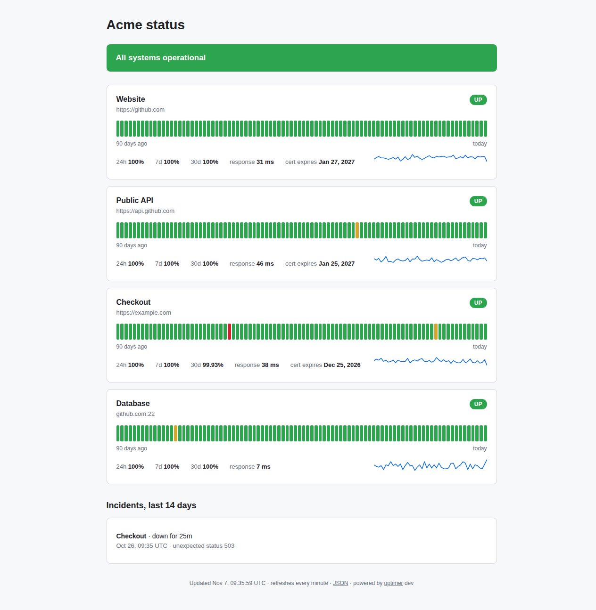

<div align="center">

# uptimer

**Self-hosted uptime monitoring in one small binary: checks, alerts and a public status page.**

Point it at your websites, APIs and servers. It checks them every minute, tells you on Telegram, Slack, Discord or
email when something goes down (and when it's back), warns you before TLS certificates expire, and publishes a
clean status page with 90 days of history. One Go binary and a SQLite file: no database server, no Node, no Docker
required.

[](https://github.com/AndreaAcanfora/uptimer/actions/workflows/ci.yml)
[](go.mod)
[](LICENSE)
[](https://www.paypal.com/paypalme/AndreaAca)

</div>

---



_The status page, with 90 days of history. It refreshes itself, follows the system light/dark theme and works on
phones. No JavaScript._

## Features

- **HTTP(S) checks**: expected status codes, a word or JSON snippet the response must contain, custom headers,
  method, timeout. **TCP checks** for databases, mail servers, SSH, anything with a port.
- **No false alarms**: a check is declared down only after N consecutive failures (2 by default).
- **Alerts on change only**: one message when a service goes down, one when it recovers, with how long it was
  down. Restarting uptimer during an outage doesn't send the alert again.
- **TLS certificate warnings** a configurable number of days before expiry, at most once a day.
- **Notifications**: Telegram, Slack, Discord, any webhook (JSON), email over SMTP.
- **Status page** with 24h / 7d / 30d uptime, 90 daily bars, response-time chart and incident history.
- **README badges**: `` and 30-day uptime badges.
- **JSON API** at `/api/status` for your own dashboards; `/healthz` for load balancers.
- **Machine-readable status** in the [Open Status Document](https://github.com/AndreaAcanfora/statusdoc)
  format at `/api/v2/summary.json`, the shape status page clients already read, with discovery at
  `/.well-known/status`. Tools can check your status by domain:
  `statusdoc check status.example.com`.
- **One static binary** for Linux, macOS, Windows and FreeBSD (amd64 and arm64), or a small Docker image (~15 MB).
  Data in SQLite, pruned automatically after 90 days.
- **Secrets stay out of the config file**: write `${TELEGRAM_BOT_TOKEN}` and set the environment variable.

## Quick start

```bash
go install github.com/AndreaAcanfora/uptimer/cmd/uptimer@latest   # or download a binary from Releases

uptimer init                 # writes an example uptimer.yml
$EDITOR uptimer.yml          # list what you want to monitor
uptimer check                # probe everything once and print a table
uptimer run                  # monitor + status page on http://localhost:8080
```

```console
$ uptimer check        # with the example config: two hosts in it don't exist
CHECK          STATUS  TIME   DETAIL
Website        up      57 ms  HTTP 200, cert 48d
API health     DOWN    3 ms   DNS lookup failed: no such host
Database port  DOWN    11 ms  DNS lookup failed: no such host
error: 2 of 3 checks failed
```

`uptimer check` exits with an error when a check fails, so it also works as a smoke test in CI or a cron job.

### Docker

```bash
docker run -d --name uptimer -p 8080:8080 -v "$PWD:/data" \
  -e TELEGRAM_BOT_TOKEN=... ghcr.io/andreaacanfora/uptimer:latest
```

The container reads `/data/uptimer.yml` and keeps its database next to it, in `/data`. It runs as a non-root user
(uid 65532): make the mounted directory writable for it, or use a named volume.

## Configuration

```yaml
title: Acme status
listen: ":8080"
database: uptimer.db
retention: 90d

defaults:
  interval: 1m
  timeout: 10s
  failure_threshold: 2      # consecutive failures before "down"
  cert_expiry_days: 14

checks:
  - name: Website
    url: https://example.com

  - name: API
    url: https://api.example.com/health
    expect_status: [200]
    contains: '"status":"ok"'
    headers:
      Authorization: Bearer ${API_TOKEN}
    interval: 30s

  - name: Postgres
    type: tcp
    address: db.example.com:5432

notify:
  telegram:
    bot_token: ${TELEGRAM_BOT_TOKEN}
    chat_id: "123456789"
  webhooks:
    - url: ${SLACK_WEBHOOK_URL}
      format: slack           # slack, discord or json
  email:
    host: smtp.gmail.com
    port: 587
    username: you@gmail.com
    password: ${SMTP_PASSWORD}
    from: you@gmail.com
    to: [you@gmail.com]
```

| Check field | Default | Meaning |
| --- | --- | --- |
| `name` | (required) | shown on the page and in alerts |
| `id` | from the name | URL-safe id for badges and the API (`My API` → `my-api`) |
| `type` | `http` | `http` or `tcp` |
| `url` | | HTTP(S) URL to request (`http`) |
| `method`, `headers` | `GET` | request method and extra headers |
| `expect_status` | any 2xx or 3xx | list of acceptable status codes |
| `contains` | | text the response body must contain (first 1 MB) |
| `address` | | `host:port` to connect to (`tcp`) |
| `interval`, `timeout` | `1m`, `10s` | how often, and how long to wait; durations like `30s`, `5m`, `2h`, `7d` |
| `failure_threshold` | `2` | consecutive failures before alerting |
| `cert_expiry_days` | `14` | warn when the TLS certificate expires within this many days |

The configuration is checked strictly: unknown fields, invalid URLs, duplicate ids and unset `${VARIABLES}` are
reported at startup with what to fix.

<details>
<summary><b>Setting up Telegram alerts</b></summary>

1. Talk to [@BotFather](https://t.me/BotFather), send `/newbot`, and copy the token.
2. Send any message to your new bot (or add it to a group).
3. Open `https://api.telegram.org/bot<TOKEN>/getUpdates` and copy `chat.id`.
4. Put both in `notify.telegram`, with the token in an environment variable.

</details>

### Alerts

```text
🔴 API is DOWN
https://api.example.com/health
Cause: unexpected status 502
2026-11-07 09:30 UTC
```

```text
🟢 API is back UP
https://api.example.com/health
Down for 6m
2026-11-07 09:36 UTC
```

JSON webhooks receive `kind` (`down`, `up`, `cert_expiry`), `check_id`, `check`, `target`, `at`, `cause`,
`downtime_seconds`, `cert_expires` and the ready-made `message`.

### Badges

```markdown


```

## How it works

```text
cmd/uptimer         CLI: run, check, init, version
internal/config     YAML + ${ENV} expansion + defaults + strict validation
internal/check      one HTTP or TCP probe -> result (status, latency, TLS expiry, readable error)
internal/monitor    one goroutine per check, failure threshold, up/down state, incidents, alerts
internal/notify     Telegram, webhooks (Slack/Discord/JSON), SMTP
internal/store      SQLite (pure Go, no cgo): results, incidents, uptime and daily aggregates
internal/web        status page (html/template, embedded), JSON API, SVG badges
```

The first probe of each check is spread over a few seconds so they don't all fire at once. Probes cancelled by a
shutdown are not recorded as failures. State is restored from the database on startup.

## Development

```bash
go test -race ./...          # no network needed except one DNS test
go vet ./... && go run honnef.co/go/tools/cmd/staticcheck@latest ./...
```

Releases are built by GoReleaser when a `v*` tag is pushed: binaries for every platform on the Releases page and a
multi-arch image on `ghcr.io/andreaacanfora/uptimer`.

## Roadmap

- [ ] Keyword-absent and JSON-path assertions
- [ ] DNS and ping (ICMP) checks
- [ ] Maintenance windows (no alerts, shown on the page)
- [ ] Per-check notification routing
- [ ] Hot reload of the configuration

## Support

uptimer is free and open source. If it saves you from finding out about an outage from your users, you can
[buy me a coffee on PayPal](https://www.paypal.com/paypalme/AndreaAca). Thank you!

## License

[MIT](LICENSE) © Andrea Acanfora
